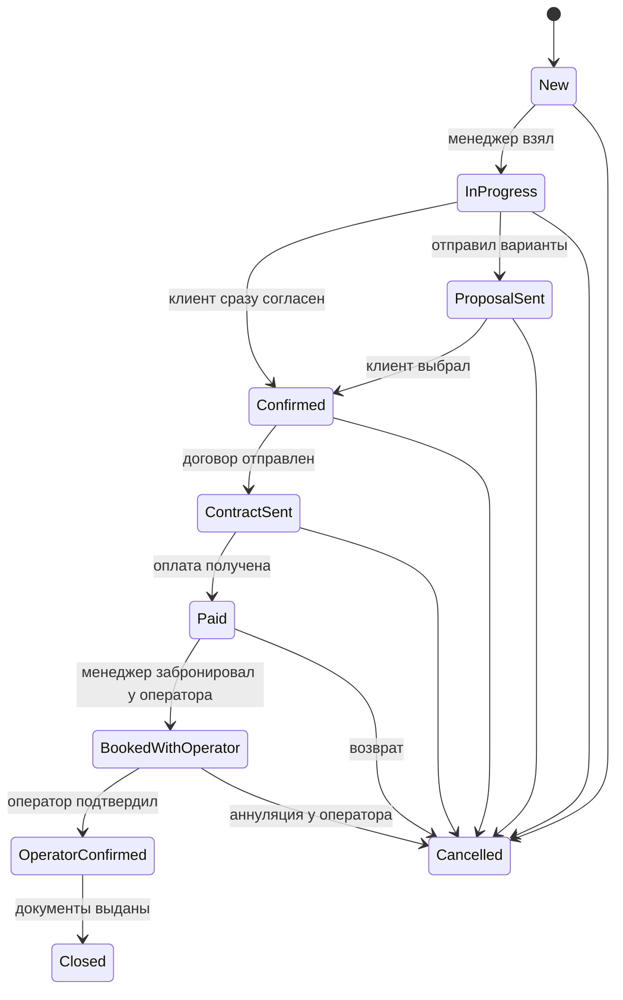
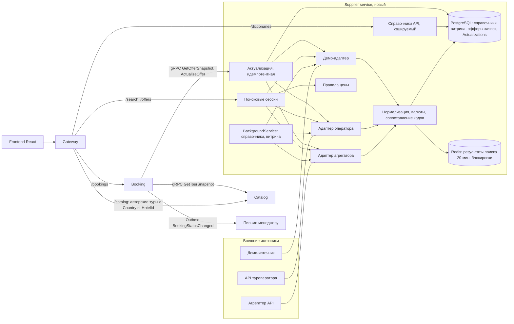
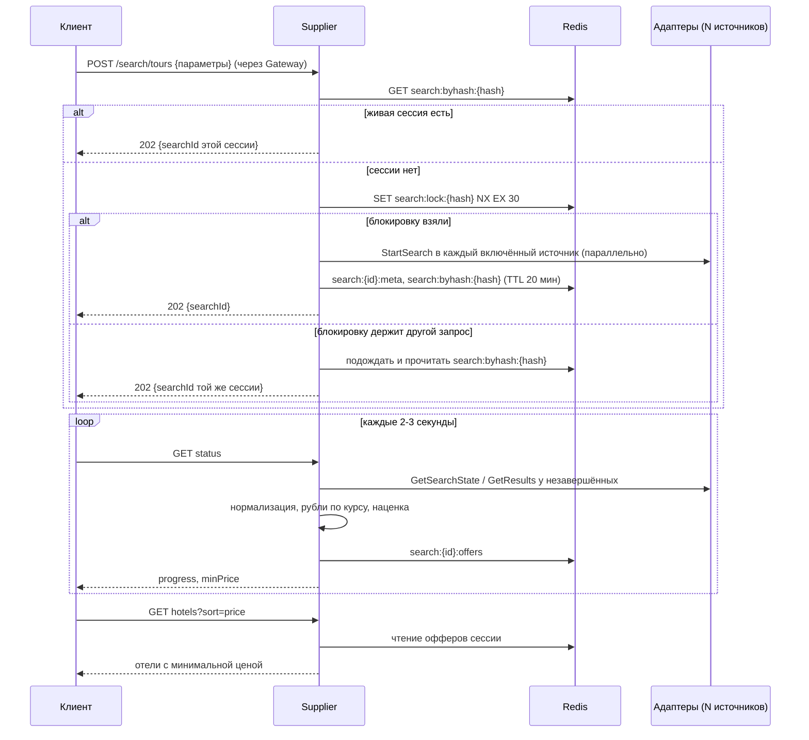
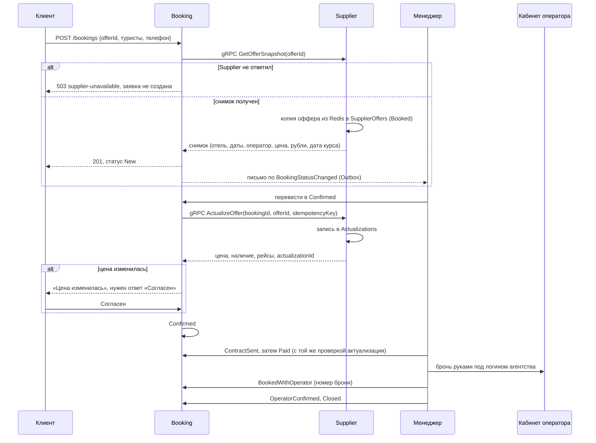
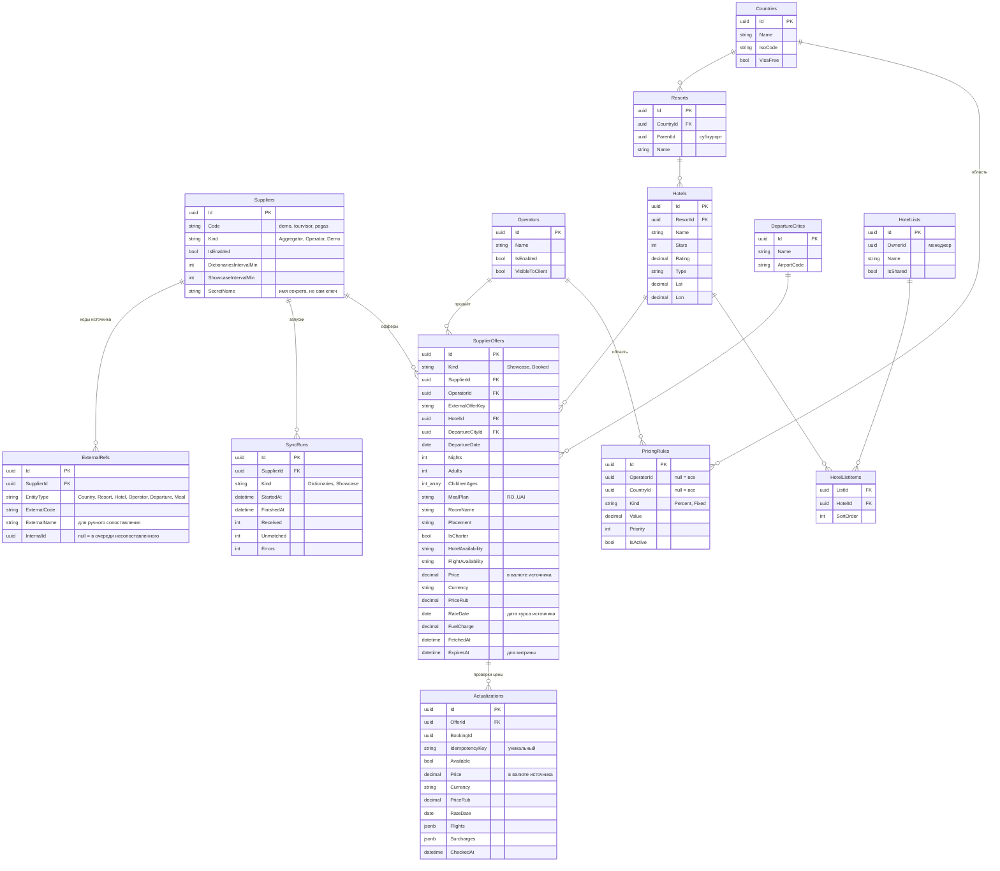
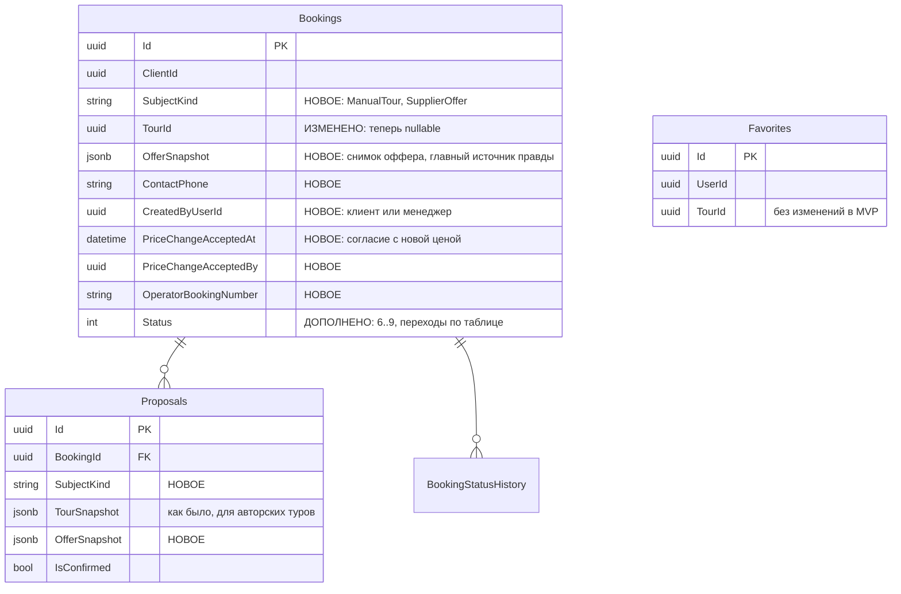

# ТЗ: агрегация туров от туроператоров, поиск, карточка предложения и бронирование

Статус: подход согласован при ревью архитектуры, детали решений в ADR-002 (вики). Раздел 8 фиксирует решения. Опирается на [vision.md](vision.md),
[domain.md](domain.md) и [tourvisor-research.md](tourvisor-research.md). Текущее состояние
кода: `src/Services/Catalog`, `src/Services/Booking`, вики `ADR-001-Tour-Model`,
`MVP-1-API-Contracts`, `Glossary`.

## 1. Цель и рамки

Сейчас каталог содержит только **авторские туры**: менеджер заводит каждый тур руками
через мастер (`Tour`, `TourOffer`, `TourDay`, `TourInclusion`, `TourImage`). Цель этого
ТЗ: сайт сам получает туры от ~10 туроператоров, клиент ищет их как в Tourvisor, видит
карточку предложения с оператором и оставляет заявку на конкретные даты; менеджер
актуализирует цену, бронирует тур у оператора и ведёт клиента до оплаты и договора.

**MVP:** один источник туров, но архитектура (адаптер на источник, единая модель,
расписание, кэш, актуализация) сразу рассчитана на все.

**Вне рамок MVP:** онлайн-оплата картой, электронная подпись договора, хранение паспортов
на сайте, автоматическая бронь у оператора по API, отдельные авиабилеты, визы.

## 2. Сквозной пример

1. Клиент открывает поиск: «Москва → Турция, вылет 10–15 мая, 7–9 ночей, 2 взрослых,
   питание от HB, отели от 4★, рейтинг от 4.0». Нажимает «Найти».
2. Сайт создаёт **поисковую сессию** и отправляет запрос во все включённые источники.
   Через 2–3 секунды клиент видит первые отели, через 10–20 секунд выдача дополняется,
   индикатор показывает «опрошено 7 из 10 операторов».
3. Выдача: отели по возрастанию минимальной цены. Отель «Sea Breeze 5★, рейтинг 4.6,
   от 182 000 ₽». Раскрываем: 12 вариантов от 4 операторов (даты, ночи, номер, питание,
   цена).
4. Клиент открывает **карточку предложения**: 12.05, 7 ночей, DBL Standard, AI, чартер,
   номер на гарантии, 182 000 ₽ за двоих, включено: перелёт, трансфер, страховка.
   Оператор показывается менеджеру всегда, клиенту по настройке.
5. Клиент жмёт «Хочу этот тур», указывает телефон и состав туристов (поля из #84). В Booking
   создаётся **заявка** со **снимком предложения**.
6. Менеджер получает уведомление, открывает заявку, жмёт «Актуализировать»: цена у
   оператора стала 184 500 ₽, места есть. Снимок обновляется, клиенту в чат уходит
   новая цена.
7. Клиент согласен → договор → оплата → менеджер бронирует тур в кабинете оператора и
   вписывает номер брони → статус «Забронировано у оператора» → «Подтверждено оператором».

## 3. Функциональные требования

### 3.1. Источники и адаптеры

- **Источник (Supplier)** это то, откуда приходят туры: агрегатор (через него много
  операторов), отдельный туроператор или демо-источник.
- На каждый тип источника пишется **адаптер**: класс, который реализует единый
  интерфейс и переводит формат источника в нашу модель. Остальная система про форматы
  источников ничего не знает.

```csharp
// Набросок контракта, не код к реализации.
public interface ISupplierAdapter
{
    string Code { get; }                        // "demo", "tourvisor", "pegas"
    SupplierCapabilities Capabilities { get; }  // что умеет: поиск, актуализация, горящие
    Task<DictionarySnapshot> LoadDictionariesAsync(CancellationToken ct);
    Task<string> StartSearchAsync(SearchQuery query, CancellationToken ct);       // id поиска у источника
    Task<SupplierSearchState> GetSearchStateAsync(string externalSearchId, CancellationToken ct);
    Task<IReadOnlyList<SupplierOffer>> GetResultsAsync(string externalSearchId, CancellationToken ct);
    Task<ActualizationResult> ActualizeAsync(string externalOfferKey, CancellationToken ct);
}
```

Пример: адаптер агрегатора, у которого поиск асинхронный, просто проксирует старт и
опрос. Адаптер оператора, у которого поиск синхронный, в `StartSearchAsync` сразу
выполняет запрос и кладёт результат во временное хранилище, а `GetSearchStateAsync`
возвращает «готово». Снаружи оба выглядят одинаково.

- Источник можно включить и выключить в админке без деплоя. Ключи доступа хранятся в
  секретах окружения (`Suppliers__Tourvisor__Token` и т.п.), в базе только ссылка на имя
  секрета. В репозитории ключей нет.
- У каждого источника свои лимиты (например, у Tourvisor 300 запросов в минуту и 3 000
  поисков в сутки), адаптер их соблюдает и сообщает о превышении.

### 3.2. Нормализация в единую модель

- **Справочники**: города вылета, страны, курорты, отели, типы питания, туроператоры.
  Хранит их **только Supplier**. У каждого источника свои коды, поэтому есть **таблица
  соответствий** `ExternalRefs`: (источник, тип сущности, внешний код) → наш id.
- Пример: у источника A Турция это `4`, у источника B `TR`, у нас
  `Country 7c1e…`. Отель «Sea Breeze» у A `2341`, у B `SB-ANT-01`, у нас один `Hotel`.
- **Сопоставление в MVP только вручную.** Новый код без соответствия попадает в очередь
  «несопоставлено». Админ либо связывает его с существующей записью, либо создаёт новую.
  Офферы с несопоставленным отелем в выдачу не попадают, но учитываются в статистике
  запуска. Автоматическое сопоставление по названию и координатам делаем позже.
- Справочники отдаются публичным **кэшируемым эндпоинтом** Supplier
  (`GET /api/v1/dictionaries/...`, заголовки `Cache-Control` и `ETag`). Фронт берёт
  оттуда названия стран, курортов и отелей, в том числе для авторских туров Catalog.
- Питание приводится к существующему `MealPlan` (RO, BB, HB, FB, AI, UAI). Пример:
  «Ultra All Inclusive», «UAL», «UALL» → `UAI`.
- **Валюты.** У каждой цены три части: сумма в валюте источника, сумма в рублях по
  курсу источника и дата этого курса. Клиент видит рубли. Сортировка, фильтр по цене и
  «цена от» считаются только по рублёвой сумме. Пример: оператор отдал 2 000 USD по
  курсу 91,50 на 20.04 → храним `2000 USD`, `183 000 ₽`, `2027-04-20`; клиент видит
  183 000 ₽. Если источник курса не отдаёт, берём курс из справочника курсов этого
  источника (у Tourvisor есть такой метод). Это же правило закрывает вопрос #62 (см.
  раздел 8). Топливный сбор и доплаты хранятся так же.

### 3.3. Расписание обновления и кэш

Туры нельзя выгрузить «целиком»: оператор за запрос отдаёт ограниченное число вариантов
(у Tourvisor 100–400), цены меняются постоянно. Поэтому данные живут по-разному:

| Что | Как получаем | Где храним | Сколько живёт | Пример |
|-----|--------------|-----------|---------------|--------|
| Справочники | фоновая задача по расписанию | PostgreSQL | до следующего обновления (раз в сутки) | список отелей Турции |
| Витрина (популярные направления, горящие, «цены от») | фоновая задача с фиксированными запросами | PostgreSQL `SupplierOffers` (`Kind = Showcase`) | несколько часов, помечаем «цена на HH:MM» | «Москва → Турция, ближайшие 2 недели, 7 ночей, 2 взр.» каждые 3 часа |
| Результаты поиска клиента | онлайн при запросе | **только Redis**, TTL 20 минут | 20 минут | запрос из примера раздела 2 |
| Оффер, по которому создана заявка | копируется из Redis при создании заявки | PostgreSQL `SupplierOffers` (`Kind = Booked`) | бессрочно | 12.05, 7 ночей, Sea Breeze |
| Актуализация | по кнопке и перед переходами `Confirmed`, `Paid` | PostgreSQL `Actualizations` | результат действует 30 минут | 184 500 ₽ в 14:05 |

Главный источник правды о том, что выбрал клиент, всё равно **снимок в Booking**
(`OfferSnapshot`). Строка `SupplierOffers` с `Kind = Booked` нужна Supplier для
повторной актуализации и разбора спорных случаев.

**Ключи Redis** (пример):

```
search:{searchId}:meta        параметры, статусы источников, прогресс     TTL 20 мин
search:{searchId}:offers      нормализованные офферы (hash offerId -> json) TTL 20 мин
search:byhash:{paramsHash}    searchId живой сессии с такими параметрами   TTL 20 мин
search:lock:{paramsHash}      блокировка на время старта поиска            TTL 30 с
```

**Склейка одинаковых поисков.** Два клиента одновременно ищут одно и то же:
1. Supplier считает хэш нормализованных параметров.
2. Если есть `search:byhash:{hash}`, второй клиент получает тот же `searchId`, новых
   запросов к источникам нет.
3. Если нет, Supplier берёт блокировку `SET search:lock:{hash} NX EX 30`. Кто взял,
   запускает поиск и пишет `byhash`. Кто не взял, коротко ждёт и читает `byhash`.
   Так один и тот же поиск не стартует дважды и не тратит лимит источника.

**Фоновые задачи** в MVP: `BackgroundService` + `PeriodicTimer` с интервалом из
настроек (справочники раз в сутки, витрина каждые 3 часа). Защита от запуска на двух
экземплярах сервиса: advisory lock в PostgreSQL. История запусков в `SyncRuns` (когда,
сколько получено, сколько ошибок, длительность). Quartz.NET подключим позже, когда
понадобятся cron-выражения или запуски, которые переживают рестарт.

### 3.4. Поиск и сортировка

**Параметры** (как у Tourvisor, см. research, раздел 2): город вылета*, страна*,
курорты, даты вылета* (диапазон до 21 дня), ночи* (1–28, диапазон до 10), взрослые*
(1–6), дети с возрастами (до 3), питание от, звёзды от, рейтинг от (любой / 3.0 / 3.5 /
4.0 / 4.5), тип отеля, цена от/до, туроператоры, только чартеры, конкретные отели или
**подборка отелей**. Звёздочкой отмечены обязательные.

**Сортировки**: цена (по умолчанию, по возрастанию), рейтинг отеля, звёзды, ближайшая
дата вылета. Сортировки по популярности в MVP нет.

**Выдача**: отели (страница по 20) с минимальной ценой и количеством вариантов, внутри
отеля варианты, отсортированные по цене. Фильтры по уже полученным результатам (питание,
звёзды, операторы, цена) применяются без нового запроса к источникам.

**UI** (можно удобнее Tourvisor): форма в одну строку на десктопе и шагами на мобильном;
прогресс «опрошено N из M операторов»; кнопка «показать новые варианты», а не
перерисовка списка под пальцем; календарь с доступными датами вылета.

**API** (через Gateway, публично, без входа):

```
POST /api/v1/search/tours                 -> 202 { "searchId": "s_8f2…" }
GET  /api/v1/search/tours/{searchId}/status
     -> { "progress": 70, "suppliersDone": 7, "suppliersTotal": 10, "minPrice": 182000, "currency": "RUB" }
GET  /api/v1/search/tours/{searchId}/hotels?sort=price&page=1&meal=AI&starsFrom=4
GET  /api/v1/search/tours/{searchId}/hotels/{hotelId}/offers?sort=price
GET  /api/v1/dictionaries/departures | countries?departureId= | resorts?countryId= | hotels?countryId=&q= | meals | operators
```

Пример ответа `hotels`:

```json
{
  "items": [
    {
      "hotelId": "h_1d3…", "name": "Sea Breeze", "stars": 5, "rating": 4.6,
      "country": "Турция", "resort": "Анталья",
      "minPrice": { "amount": 182000, "currency": "RUB" },
      "offersCount": 12, "coverMediaFileId": null
    }
  ],
  "page": 1, "pageSize": 20, "total": 143, "complete": false
}
```

### 3.5. Карточка предложения

`GET /api/v1/offers/{offerId}`: отель (звёзды, рейтинг, курорт, фото), город вылета, дата
вылета и возврата, ночи, номер и размещение, питание, тип рейса (чартер/регулярный),
наличие мест в отеле и на рейсе («есть / мало / под запрос»), что включено (перелёт,
трансфер, страховка) и что нет, цена за всех и за человека, время получения цены
(«цена на 14:02»), **туроператор**.

- Менеджер и админ видят оператора всегда, плюс внешнюю ссылку на тур у оператора, если
  источник её отдаёт.
- Клиент видит оператора по настройке сайта (см. 3.7).
- Кнопка «Проверить цену» (актуализация) доступна менеджеру всегда, клиенту не чаще
  раза в N минут на предложение (лимит источника).
- Если оффер истёк (сессия старше 20 минут), карточка показывает последнюю известную цену
  и предлагает повторить поиск или актуализировать.

### 3.6. Заявка и бронирование

Заявку создаёт клиент («Хочу этот тур») или менеджер от имени клиента (клиент пришёл в
офис или написал в мессенджер).

Обязательные поля заявки: предложение (или авторский тур), состав туристов, телефон.
Необязательные: бюджет, комментарий, удобный способ связи.

Статусы (существующие значения сохраняются, новые добавляются в конец):



Правила:
- **Статусы не сравниваются числами.** `Paid = 7` больше `Confirmed = 3`, но это не
  значит «дальше по процессу»: значения enum добавлялись в конец по мере развития.
  Проверка `if (status > BookingStatus.Confirmed)` запрещена. Разрешённые переходы
  задаются **явной таблицей** в доменной модели (`Booking`), сейчас это `switch` в
  `IsValidTransition`, его расширяем. Все остальные переходы дают доменную ошибку и
  ответ 409.

  | Из статуса | Можно перейти в | Кто | Условие |
  |-----------|-----------------|-----|---------|
  | New | InProgress, Cancelled | менеджер; отмена: менеджер или клиент | |
  | InProgress | ProposalSent, Confirmed, Cancelled | менеджер | ProposalSent: есть хотя бы одно предложение (как сейчас) |
  | ProposalSent | Confirmed, InProgress, Cancelled | Confirmed: клиент или менеджер | |
  | Confirmed | ContractSent, Cancelled; **Closed** только для авторского тура | менеджер | для оффера: свежая актуализация и согласие клиента с ценой (см. ниже) |
  | ContractSent | Paid, Cancelled | менеджер | для оффера: свежая актуализация и согласие клиента с ценой |
  | Paid | BookedWithOperator, Cancelled (возврат) | менеджер | |
  | BookedWithOperator | OperatorConfirmed, Cancelled (аннуляция у оператора) | менеджер | указан номер брони у оператора |
  | OperatorConfirmed | Closed, Cancelled | менеджер | |
  | Closed, Cancelled | (нет) | | финальные статусы |

  Переход `Confirmed → Closed` есть в текущем коде, его сохраняем для авторских туров,
  чтобы не сломать существующий процесс. Для заявок на оффер путь идёт через договор,
  оплату и бронь у оператора. Тест: на каждую пару (из, в) ожидаемый результат.
- **Актуализация перед `Confirmed` и `Paid`** (для заявки на оффер):
  - Booking вызывает `ActualizeOffer(bookingId, offerId, idempotencyKey)`. Ключ
    идемпотентности строится из заявки и целевого статуса (например,
    `{bookingId}:Paid:{попытка}`). Повтор с тем же ключом возвращает уже сохранённый
    результат и не делает нового запроса к источнику (сбой сети, двойной клик).
  - Результат пишется в таблицу `Actualizations` в Supplier (цена в валюте источника и в
    рублях, наличие мест, рейсы, время). Снимок в Booking получает `ActualizationId` и
    новую цену.
  - Если последней актуализации больше 30 минут, переход блокируется до новой проверки.
  - Если цена изменилась (в любую сторону), переход требует **согласия клиента**: клиент
    в заявке видит «Цена изменилась: было 182 000 ₽, стало 184 500 ₽» и кнопки
    «Согласен» / «Отказаться». Без согласия переход даёт 409. Менеджер может отметить
    согласие за клиента, если тот подтвердил его в чате или по телефону. Отметка пишется
    в историю с автором.
  - Если мест нет, переход невозможен, менеджер предлагает альтернативы.
- **Недоступность Supplier.** Заявка на оффер без снимка не создаётся. Если Supplier не
  ответил (таймаут, сервис лежит), Booking отвечает **503** в формате ProblemDetails
  (`type: .../errors/supplier-unavailable`) и ничего не сохраняет. Текст в интерфейсе:

  > Не получилось проверить этот тур у туроператора. Заявка не отправлена. Попробуйте
  > ещё раз через минуту или напишите нам в чат, менеджер поможет.

  Кнопки: «Повторить» и «Написать менеджеру». Заявки на **авторские туры** от Supplier
  не зависят и создаются как сейчас (Booking → Catalog).
- Бронь у оператора в MVP менеджер делает в кабинете оператора руками, на сайте вписывает
  номер брони. Бронировать до оплаты сайт не даёт (штраф за аннуляцию).
- Паспортные данные в MVP на сайт не загружаются, договор и паспорта идут вне сайта.
  На сайте только состав туристов (взрослые, возраст детей), см. #84.
- Каждый переход пишется в `BookingStatusHistory` (уже есть), событие
  `BookingStatusChanged` уходит через Outbox (уже есть). По нему в MVP отправляется письмо
  менеджеру (раздел 5.3).

### 3.7. Цена для клиента и видимость оператора

- **Цена клиента** = розничная цена оператора + наценка по правилам (`PricingRules`).
  Правило: процент или фиксированная сумма; область: все, оператор, страна, оператор +
  страна. Пример: «Абхазия, все операторы, +1 500 ₽ за заявку». По умолчанию правил нет и
  клиент видит цену оператора.
- Менеджер в карточке видит обе цены: оператора и клиента, и разницу.
- **Видимость оператора клиенту**: настройка сайта «показывать / скрывать» (по умолчанию
  решает владелец продукта, см. открытые вопросы).
- Применение правил делается в одном месте (сервис цены), чтобы выдача, карточка и
  снимок в заявке не разошлись.

### 3.8. Подборки отелей

Менеджер создаёт подборку («Проверенные отели Кемера»), добавляет отели из справочника и
выбирает её в поиске: выдача содержит только эти отели. Подборку можно сделать общей для
всех менеджеров. Клиенту подборка показывается как страница «Рекомендуем» с живыми ценами
(после MVP).

### 3.9. Администрирование источников

Раздел админа: список источников (вкл/выкл, расписание, последний запуск, ошибки, расход
лимита за сутки), очередь несопоставленных кодов, операторы (вкл/выкл в поиске, видимость
клиенту), правила наценки.

## 4. Архитектура и варианты

Все варианты ниже рассмотрены при ревью архитектуры. Выбранный отмечен «Решено».

### 4.1. Где живёт интеграция

| Вариант | Плюсы | Минусы |
|---------|-------|--------|
| **A. Новый сервис `Supplier`** | изоляция внешних API: сбой или медленный оператор не валит каталог; свои фоновые задачи, лимиты, секреты; свой масштаб; понятная граница «внешний мир ↔ мы» | ещё один сервис в compose и CI; межсервисные вызовы Booking → Supplier |
| B. Внутри Catalog | меньше инфраструктуры | Catalog смешивает ручной контент и интеграции; внешние таймауты в одном процессе с публичной выдачей |

**Решено: A.** Справочники стран, курортов и отелей хранит только Supplier.

### 4.2. Хранить предложения или искать онлайн

| Вариант | Плюсы | Минусы |
|---------|-------|--------|
| Хранить всё в своей базе | быстрый поиск, свои сортировки | всю базу оператора не получить; цены устаревают за минуты |
| Только онлайн | всегда свежие цены | медленно (до 20 с), каждый поиск тратит лимит; нет витрины |
| **Гибрид** | онлайн-поиск + кэш сессий 20 минут + витрина по расписанию + актуализация перед бронью | два пути данных, нужно честно показывать время цены |

**Решено: гибрид.** Результаты клиентского поиска только в Redis (TTL 20 минут). В
PostgreSQL витрина и офферы, по которым создана заявка (раздел 3.3).

### 4.3. Источник для MVP

| Вариант | Плюсы | Минусы |
|---------|-------|--------|
| Агрегатор (Tourvisor API или Sletat) | один ключ даёт ~90+ операторов; документированный асинхронный поиск и актуализация | платно (от 5 000 ₽/мес у Tourvisor), нужен договор агентства |
| Туроператор напрямую | без посредника | договор с оператором, доп. соглашение на API, белый список IP; у каждого свой формат |
| **Демо-источник первым шагом** | бесплатно; проверяет весь конвейер; удобно для тестов | данные ненастоящие |

MVP строим на демо-адаптере, который ведёт себя как настоящий источник (асинхронный
старт, разное время ответа, ограниченное число туров, иногда ошибка, иногда изменение цены
при актуализации). Какой реальный источник подключаем первым, решает владелец продукта
(раздел 8).

### 4.4. Фоновые задачи

| Вариант | Плюсы | Минусы |
|---------|-------|--------|
| **`BackgroundService` + `PeriodicTimer` и `SyncRuns`** | ничего нового, всё видно в коде | интервалы вместо cron; при нескольких экземплярах нужна блокировка (advisory lock) |
| Quartz.NET / Hangfire | cron, повторы, запуски переживают рестарт | новая зависимость |

**Решено:** в MVP `BackgroundService` + `PeriodicTimer`. Quartz позже, когда понадобятся
cron или запуски, переживающие рестарт.

### 4.5. Как Booking получает данные предложения

| Вариант | Плюсы | Минусы |
|---------|-------|--------|
| **gRPC `supplier.proto`**: `GetOfferSnapshot`, `ActualizeOffer` | так уже устроен Booking → Catalog (`GetTourSnapshot`) | Booking зависит от доступности Supplier (решается 503, раздел 3.6) |
| Клиент присылает снимок в запросе | просто | доверять цене от клиента нельзя |

**Решено: gRPC.** Без ответа Supplier заявка на оффер не создаётся (503), заявки на
авторские туры от Supplier не зависят.

### 4.6. Схема сервисов и потока данных



Фронт показывает названия стран и отелей у авторских туров, сопоставляя `CountryId` и
`HotelId` из Catalog со справочником Supplier. Catalog в Supplier не ходит.

### 4.7. Поиск по шагам



### 4.8. Заявка и бронь по шагам



### 4.9. ER-схема новых и изменённых таблиц

Supplier (новая база). Поисковых сессий в PostgreSQL нет, они живут в Redis (раздел 3.3).



Booking (изменения):



Состав туристов, даты и бюджет в заявке делаются в #84 и здесь не дублируются.
Избранное отелей отложено (раздел 8).

`OfferSnapshot` (value object, хранится jsonb): `SupplierCode`, `ExternalOfferKey`,
`OfferId`, `OperatorId`, `OperatorName`, `HotelId`, `HotelName`, `Stars`, `Country`,
`Resort`, `DepartureCity`, `DepartureDate`, `Nights`, `RoomName`, `Placement`,
`MealPlan`, `IsCharter`, `OperatorPrice` и `Currency` (в валюте источника), `PriceRub`,
`RateDate`, `ClientPriceRub`, `PriceAt`, `ActualizationId`, `ActualizedAt`. Пример:

```json
{
  "supplierCode": "demo", "operatorName": "Оператор A", "actualizationId": null,
  "hotelName": "Sea Breeze", "stars": 5, "country": "Турция", "resort": "Анталья",
  "departureCity": "Москва", "departureDate": "2027-05-12", "nights": 7,
  "roomName": "DBL Standard", "mealPlan": "AI", "isCharter": true,
  "operatorPrice": 182000, "currency": "RUB", "priceRub": 182000, "rateDate": "2027-04-20",
  "clientPriceRub": 182000, "priceAt": "2027-04-20T11:02:00Z", "actualizedAt": null
}
```

## 5. Что меняется в текущей модели

### 5.1. Catalog

| Что | Сейчас | Станет | Почему |
|-----|--------|--------|--------|
| `Tour` и дочерние (`TourOffer`, `TourDay`, `TourInclusion`, `TourImage`, `TourComponent`) | единственный вид тура | остаются как **авторские туры** без изменений структуры | ручные туры нужны; переписывать мастер незачем |
| `TourSource.Automation` | зарезервировано под автоматизацию | не используется: туры операторов живут в Supplier. Значение в enum оставляем, помечаем устаревшим | у оффера оператора другая природа |
| `Tour.Country` (строка), `Tour.DirectionId` | страна текстом, направление | добавить необязательный `CountryId`. **Catalog хранит только id**, названия фронт берёт из справочника Supplier. Строку `Country` удалим после заполнения `CountryId` | один владелец справочников |
| `Direction` | страна + название | получает `CountryId`; страница направления ведёт в поиск по стране | связь с поиском |
| `Tour.AccommodationText` | отель текстом | добавить необязательный `HotelId` (только id) | ADR-001 обещал отель как сущность на этапе 2 |
| цена авторского тура (`TourOffer.Currency`, по умолчанию `USD`) | сравнение без учёта валюты (#62) | то же правило, что у офферов: сумма в валюте + рубли + дата курса, сравнение по рублям. Откуда брать курс для авторских туров, см. раздел 8 | #62 |
| `Tour.ImageUrl` | колонка не отдаётся в API | удаляется в #81, как и планировалось | не связано с агрегацией |
| `DurationDays` | длительность в днях | остаётся для авторских туров; у офферов `Nights`. В UI «7 ночей / 8 дней» | у операторов принято считать ночи |
| публичный `GET /catalog/tours` | все туры | только авторские туры; поиск офферов идёт через `/search` | разные источники данных |

Catalog не ходит во внешние API, не хранит офферы и не хранит копию справочников. Копию
по событиям из Supplier заведём, только если понадобится (например, для поиска по
названию страны внутри Catalog).

### 5.2. Booking

| Что | Сейчас | Станет |
|-----|--------|--------|
| `Booking.TourId` | обязательный | nullable + `SubjectKind` (`ManualTour` или `SupplierOffer`). Инвариант: для `ManualTour` есть `TourId`, для `SupplierOffer` есть `OfferSnapshot` |
| снимок | `TourSnapshot` только в `Proposal` | `OfferSnapshot` в самой заявке (что клиент выбрал) и в `Proposal` (что предложил менеджер) |
| телефон | нет | новое поле, обязателен (без контакта нельзя оформить договор). Состав туристов, даты и бюджет делаются в #84 |
| кто создал | всегда клиент (`ClientId`) | `CreatedByUserId`: заявку может создать менеджер за клиента |
| `BookingStatus` | New, InProgress, ProposalSent, Confirmed, Closed, Cancelled (0–5) | плюс ContractSent = 6, Paid = 7, BookedWithOperator = 8, OperatorConfirmed = 9. Существующие числа не меняются |
| переходы | `switch` в `IsValidTransition` на 6 статусов | явная таблица разрешённых переходов на 10 статусов (раздел 3.6), без сравнения чисел; правило «идемпотентная актуализация не старше 30 минут и согласие клиента с новой ценой» перед `Confirmed` и `Paid` |
| номер брони у оператора | нет | `OperatorBookingNumber` (оператор берётся из снимка) |
| согласие с новой ценой | нет | `PriceChangeAcceptedAt`, `PriceChangeAcceptedBy` |
| ошибки | 422 `tour-unavailable` | плюс 503 `supplier-unavailable` для заявки на оффер (раздел 3.6) |
| `Favorite.TourId` | только авторские туры | без изменений в MVP. Избранное отелей из поиска отложено (офферы живут 20 минут, хранить пришлось бы отель, а не оффер) |
| gRPC | Booking → Catalog `GetTourSnapshot` | плюс Booking → Supplier `GetOfferSnapshot`, `ActualizeOffer` |

### 5.3. Остальное

- **Gateway**: маршруты `/api/v1/search/**`, `/api/v1/offers/**`,
  `/api/v1/dictionaries/**` публичные (GET и POST поиска) с rate limit;
  `/api/v1/supplier/manage/**` только менеджер и админ.
- **Frontend**: новая страница поиска, выдача, карточка предложения, раздел админа
  «Источники»; страница «Туры» показывает поиск и блок авторских туров.
- **Media**: фото отелей от источника не копируем в MinIO, пока не выяснены права (раздел 8); показываем заглушку или собственные фото агентства, загруженные
  через Media с отметкой источника.
- **Уведомления**: в MVP письмо менеджеру по событию `BookingStatusChanged` из Outbox
  (включая создание заявки). Общий механизм уведомлений (сайт, мессенджеры) делаем вместе
  с эпиком #91.
- **Вики**: обновить `Glossary` (оффер ≠ Proposal), ADR-002 «Агрегация туров» ведётся в вики.

### 5.4. Миграция данных

1. Supplier: новая база, данных переносить не нужно. Сидер справочников из демо-источника.
2. Booking: `ALTER` добавляет колонки; у всех существующих заявок
   `SubjectKind = ManualTour`, `TourId` сохраняется, `CreatedByUserId = ClientId`.
   Существующие `Proposal` получают `SubjectKind = ManualTour`. Статусы 0–5 не трогаем.
3. Catalog: `CountryId` и `HotelId` добавляются пустыми, менеджер заполняет их, выбирая
   из справочника Supplier; `Country` строкой удаляется только после этого.
4. Проверка как в ADR-001: прогон миграций на дампе, сверка количества заявок и
   предложений до и после.

### 5.5. Что удаляется

- Ничего из рабочего функционала. Удаляются: `Tour.ImageUrl` (#81), позже
  `Tour.Country` строкой (после заполнения `CountryId`).
- `TourSource.Automation` не удаляется, а помечается устаревшим.

## 6. Нефункциональные требования

- **Время**: первые результаты поиска до 5 секунд, полная выдача до 30 секунд; источник,
  который не ответил за 30 секунд, помечается «не ответил», поиск не ждёт его дальше.
- **Устойчивость**: таймауты и повтор с паузой на каждый вызов источника; если источник
  падает подряд N раз, временно отключаем его в поиске (circuit breaker) и показываем
  админу.
- **Лимиты**: суточный и поминутный счётчики на источник; при приближении к лимиту
  витрина обновляется реже, а клиентский поиск сильнее склеивается по хэшу.
- **Безопасность**: ключи источников только в секретах окружения; в логах нет телефонов,
  имён и паспортов (PII маскируется, как в Glossary); в репозитории нет адресов серверов и
  ключей.
- **Тесты**: на каждый адаптер контрактные тесты по сохранённым примерам ответов
  источника (без реальных запросов в CI); тесты нормализации (питание, валюты,
  сопоставление); тесты переходов статусов и правила актуализации.
- **Наблюдаемость**: метрики на источник (время ответа, ошибки, расход лимита), журнал
  `SyncRuns`.

## 7. Этапы

1. ADR-002 в вики (решения раздела 8).
2. Сервис Supplier: каркас, справочники, ручное сопоставление, демо-адаптер, валюты.
3. Поисковые сессии в Redis и API поиска, выдача по отелям, сортировки и фильтры.
4. Фронт: форма поиска, выдача, карточка предложения.
5. Booking: таблица переходов, `SubjectKind`, `OfferSnapshot`, gRPC к Supplier, 503,
   идемпотентная актуализация с согласием клиента, письмо менеджеру.
6. Админка источников, операторы, правила цены (после продуктовых решений).
7. Витрина по расписанию (горящие, «цены от»), подборки отелей.
8. Первый реальный источник (после получения доступа).

## 8. Решения и открытые вопросы

### Решения архитектора

Решено при ревью архитектуры, детали в ADR-002 (вики).

| # | Вопрос | Решение |
|---|--------|---------|
| 1 | Где живёт интеграция | отдельный сервис **Supplier** (вариант A, раздел 4.1) |
| 2 | Хранить или искать онлайн | **гибрид** подтверждён (раздел 4.2) |
| 3 | Где справочники стран, курортов, отелей | **только в Supplier**. Catalog в MVP хранит только `CountryId` и `HotelId`, названия фронт берёт из кэшируемого эндпоинта справочников Supplier. Копия по событиям, только если понадобится |
| 4, 8 | Redis или PostgreSQL для результатов поиска | результаты клиентского поиска **только в Redis**, TTL 20 минут. В PostgreSQL витрина и офферы, по которым создана заявка; главный всё равно снимок в Booking. Склейка одинаковых поисков по хэшу параметров через ключ Redis с блокировкой (раздел 3.3) |
| 5 | Фоновые задачи | MVP: `BackgroundService` + `PeriodicTimer`. Quartz позже, когда нужны cron или запуски, переживающие рестарт |
| 6 | Сопоставление отелей | в MVP **вручную** через очередь несопоставленного; автоматика по названию и координатам потом |
| 7 | Валюты | цена в валюте источника + сумма в рублях по курсу источника + дата курса; клиенту рубли; сортировка и фильтры по рублям. Закрывает и #62 |
| 9 | Уведомления менеджеру | пока **письмом** по событию `BookingStatusChanged` из Outbox; общий механизм уведомлений вместе с эпиком #91 |

Дополнительные требования с ревью (внесены в раздел 3.6):
- статусы не сравниваются числами, переходы только по явной таблице в доменной модели;
- если Supplier недоступен, заявка на оффер не создаётся (503 и понятный текст), заявки на
  авторские туры от Supplier не зависят;
- актуализация перед `Confirmed` и `Paid` идемпотентна, результат пишется в
  `Actualizations`, при изменении цены переход требует согласия клиента.

### Открытые продуктовые вопросы

1. **Первый реальный источник**: агрегатор (Tourvisor API, Sletat) или оператор напрямую?
   Есть ли доступ через договор действующего агентства и кто платит подписку? До этого
   работаем на демо-источнике.
2. **Видимость оператора клиенту**: всегда, никогда или настройка на оператора? Что
   показываем вместо названия, если скрываем?
3. **Наценка**: нужна ли в MVP, и показываем ли клиенту, что цена включает сбор
   агентства? Нужна юридическая проверка.
4. **Состав операторов**: подтвердить точные названия «Интурист», «Let's Fly», «Space
   Travel» и итоговый список из ~10.
5. **Заявка без входа**: может ли гость оставить заявку только с телефоном?
6. **Изменение цены**: согласие клиента нужно при любом изменении или только при росте /
   росте больше порога (например, 2 %)? Сейчас в ТЗ: при любом изменении.
7. **Фото отелей**: можно ли показывать фото из источника (у Tourvisor это отдельный
   платный раздел) или только собственные фото агентства и заглушки?
8. **Договор и оплата** в MVP вне сайта, подтверждаем? Что показываем клиенту об оплате?
9. **Визовые страны**: прятать из поиска или показывать с пометкой «виза оформляется
   самостоятельно»?
10. **Города вылета** по умолчанию.
11. **Курс для авторских туров** (#62): менеджер вводит цену сразу в рублях, или сумму в
    валюте и курс на дату? Предложение: рубли обязательны, валюта справочно.
12. **Избранное отелей** (клиент сохраняет отель из поиска): нужно в MVP или позже?
    Сейчас отложено.
13. **Почта для писем о заявках**: на какой адрес (общий ящик агентства или адрес
    назначенного менеджера) и с какого отправителя?
