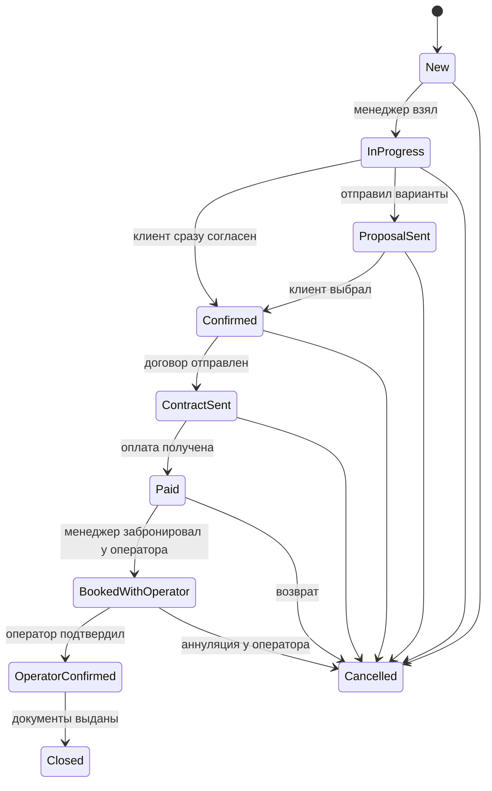
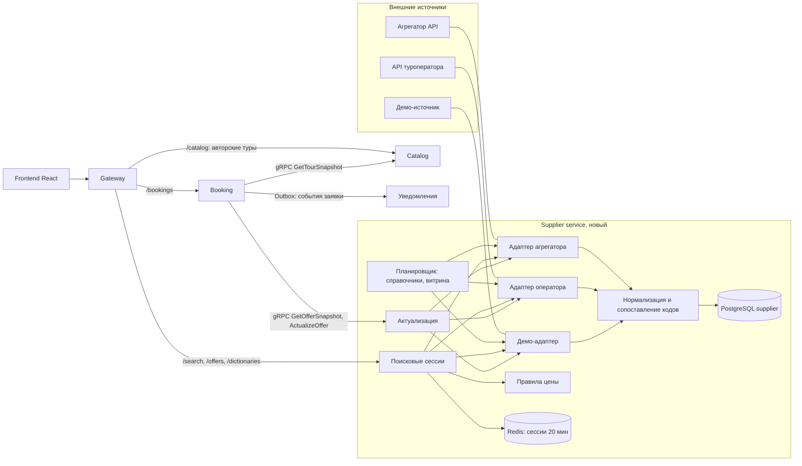
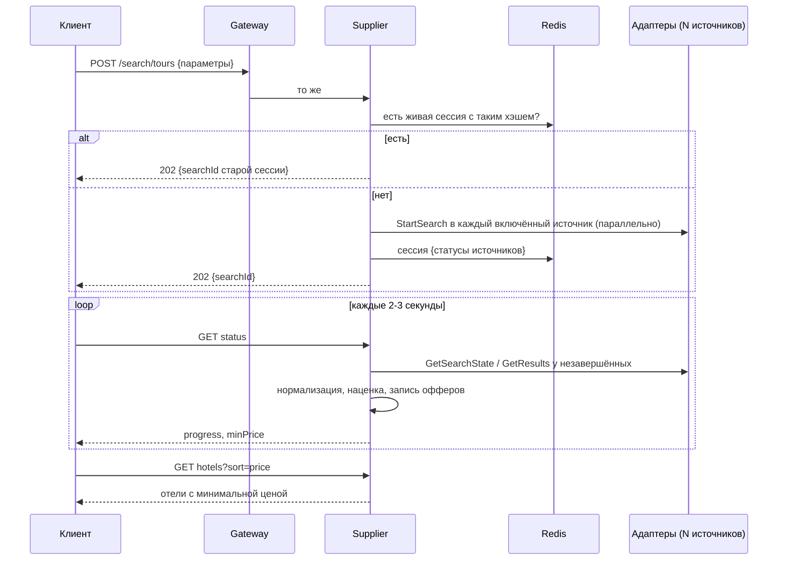
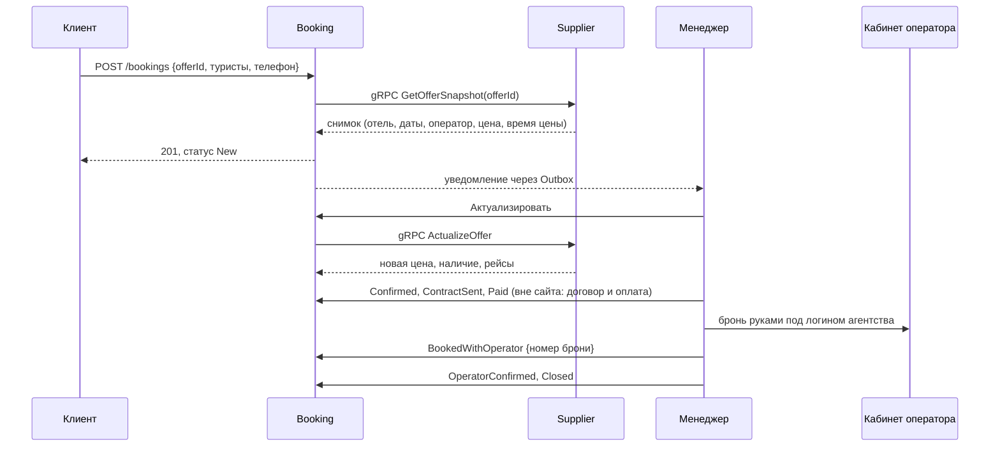
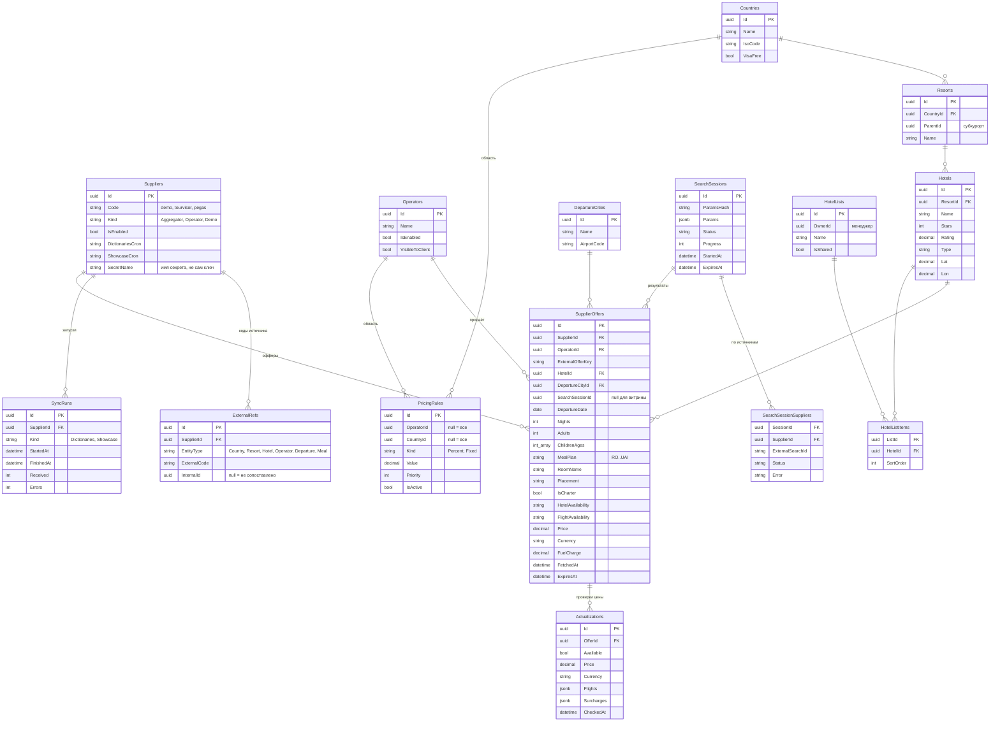
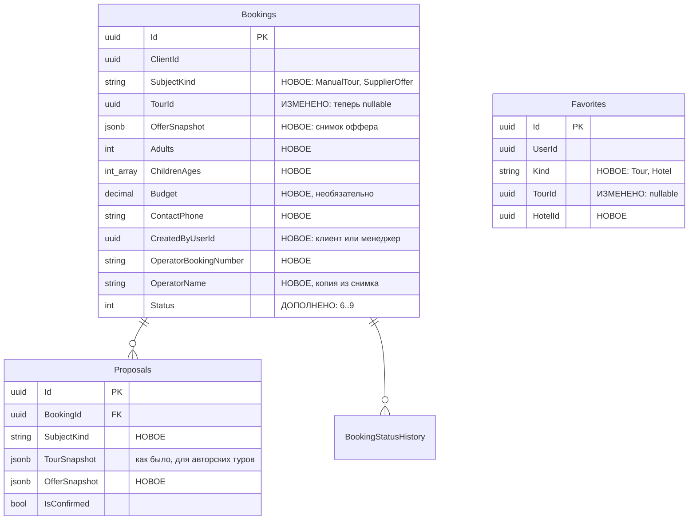

# ТЗ: агрегация туров от туроператоров, поиск, карточка предложения и бронирование

Статус: черновик на согласование архитектуры. Опирается на [vision.md](vision.md),
[domain.md](domain.md) и [tourvisor-research.md](tourvisor-research.md). Текущее состояние
кода: `src/Services/Catalog`, `src/Services/Booking`, вики `ADR-001-Tour-Model`,
`MVP-1-API-Contracts`, `Glossary`.

## 1. Цель и рамки

Сейчас каталог содержит только **авторские туры**: менеджер заводит каждый тур руками
через мастер (`Tour`, `TourOffer`, `TourDay`, `TourInclusion`, `TourImage`). Цель этого
ТЗ: сайт сам получает туры от ~10 туроператоров, клиент ищет их как в Tourvisor, видит
карточку предложения с оператором и оставляет заявку на конкретные даты; менеджер
актуализирует цену, бронирует тур у оператора и ведёт клиента до оплаты и договора.

**MVP:** один источник туров, но архитектура (адаптер на источник, единая модель,
расписание, кэш, актуализация) сразу рассчитана на все.

**Вне рамок MVP:** онлайн-оплата картой, электронная подпись договора, хранение паспортов
на сайте, автоматическая бронь у оператора по API, отдельные авиабилеты, визы.

## 2. Сквозной пример

1. Клиент открывает поиск: «Москва → Турция, вылет 10–15 мая, 7–9 ночей, 2 взрослых,
   питание от HB, отели от 4★, рейтинг от 4.0». Нажимает «Найти».
2. Сайт создаёт **поисковую сессию** и отправляет запрос во все включённые источники.
   Через 2–3 секунды клиент видит первые отели, через 10–20 секунд выдача дополняется,
   индикатор показывает «опрошено 7 из 10 операторов».
3. Выдача: отели по возрастанию минимальной цены. Отель «Sea Breeze 5★, рейтинг 4.6,
   от 182 000 ₽». Раскрываем: 12 вариантов от 4 операторов (даты, ночи, номер, питание,
   цена).
4. Клиент открывает **карточку предложения**: 12.05, 7 ночей, DBL Standard, AI, чартер,
   номер на гарантии, 182 000 ₽ за двоих, включено: перелёт, трансфер, страховка.
   Оператор показывается менеджеру всегда, клиенту по настройке.
5. Клиент жмёт «Хочу этот тур», указывает телефон и бюджет (необязательно). В Booking
   создаётся **заявка** со **снимком предложения**.
6. Менеджер получает уведомление, открывает заявку, жмёт «Актуализировать»: цена у
   оператора стала 184 500 ₽, места есть. Снимок обновляется, клиенту в чат уходит
   новая цена.
7. Клиент согласен → договор → оплата → менеджер бронирует тур в кабинете оператора и
   вписывает номер брони → статус «Забронировано у оператора» → «Подтверждено оператором».

## 3. Функциональные требования

### 3.1. Источники и адаптеры

- **Источник (Supplier)** это то, откуда приходят туры: агрегатор (через него много
  операторов), отдельный туроператор или демо-источник.
- На каждый тип источника пишется **адаптер**: класс, который реализует единый
  интерфейс и переводит формат источника в нашу модель. Остальная система про форматы
  источников ничего не знает.

```csharp
// Набросок контракта, не код к реализации.
public interface ISupplierAdapter
{
    string Code { get; }                        // "demo", "tourvisor", "pegas"
    SupplierCapabilities Capabilities { get; }  // что умеет: поиск, актуализация, горящие
    Task<DictionarySnapshot> LoadDictionariesAsync(CancellationToken ct);
    Task<string> StartSearchAsync(SearchQuery query, CancellationToken ct);       // id поиска у источника
    Task<SupplierSearchState> GetSearchStateAsync(string externalSearchId, CancellationToken ct);
    Task<IReadOnlyList<SupplierOffer>> GetResultsAsync(string externalSearchId, CancellationToken ct);
    Task<ActualizationResult> ActualizeAsync(string externalOfferKey, CancellationToken ct);
}
```

Пример: адаптер агрегатора, у которого поиск асинхронный, просто проксирует старт и
опрос. Адаптер оператора, у которого поиск синхронный, в `StartSearchAsync` сразу
выполняет запрос и кладёт результат во временное хранилище, а `GetSearchStateAsync`
возвращает «готово». Снаружи оба выглядят одинаково.

- Источник можно включить и выключить в админке без деплоя. Ключи доступа хранятся в
  секретах окружения (`Suppliers__Tourvisor__Token` и т.п.), в базе только ссылка на имя
  секрета. В репозитории ключей нет.
- У каждого источника свои лимиты (например, у Tourvisor 300 запросов в минуту и 3 000
  поисков в сутки), адаптер их соблюдает и сообщает о превышении.

### 3.2. Нормализация в единую модель

- **Справочники**: города вылета, страны, курорты, отели, типы питания, туроператоры.
  У каждого источника свои коды; храним свой справочник и **таблицу соответствий**
  `ExternalRefs`: (источник, тип сущности, внешний код) → наш id.
- Пример: у источника A Турция это `4`, у источника B `TR`, у нас
  `Country 7c1e…`. Отель «Sea Breeze» у A `2341`, у B `SB-ANT-01`, у нас один `Hotel`.
- Новые коды, которым не нашлось соответствия, попадают в очередь «несопоставлено»; админ
  связывает их вручную (позже автоматически по названию и координатам). Офферы с
  несопоставленным отелем в выдачу не попадают, но учитываются в статистике.
- Питание приводится к существующему `MealPlan` (RO, BB, HB, FB, AI, UAI). Пример:
  «Ultra All Inclusive», «UAL», «UALL» → `UAI`.
- Цена хранится как сумма + валюта (ISO), отдельно топливный сбор и доплаты, если
  источник их отдаёт.

### 3.3. Расписание обновления и кэш

Туры нельзя выгрузить «целиком»: оператор за запрос отдаёт ограниченное число вариантов
(у Tourvisor 100–400), цены меняются постоянно. Поэтому данные трёх видов живут по-разному:

| Что | Как получаем | Где храним | Сколько живёт | Пример |
|-----|--------------|-----------|---------------|--------|
| Справочники | фоновая задача по расписанию | PostgreSQL | до следующего обновления (раз в сутки) | список отелей Турции |
| Витрина (популярные направления, горящие, «цены от») | фоновая задача по расписанию с фиксированными запросами | PostgreSQL `SupplierOffers` | несколько часов, помечаем «цена на HH:MM» | «Москва → Турция, ближайшие 2 недели, 7 ночей, 2 взр.» каждые 3 часа |
| Результаты поиска клиента | онлайн при запросе | Redis (сессия) + `SupplierOffers` с `ExpiresAt` | 20 минут | запрос из примера раздела 2 |
| Актуализация | по кнопке и автоматически при заявке | `Actualizations` + снимок в Booking | 30 минут, потом нужна новая | 184 500 ₽ в 14:05 |

- Одинаковые поиски склеиваются по хэшу параметров: если такой же поиск был 5 минут назад
  и сессия жива, второй клиент получает её результаты без нового запроса к источнику
  (экономия лимитов).
- Расписание задаётся в админке на источник (cron-строка) и по умолчанию: справочники в
  04:00 (Europe/Moscow), витрина каждые 3 часа.
- История запусков (`SyncRuns`): когда, сколько получено, сколько ошибок, длительность.

### 3.4. Поиск и сортировка

**Параметры** (как у Tourvisor, см. research, раздел 2): город вылета*, страна*,
курорты, даты вылета* (диапазон до 21 дня), ночи* (1–28, диапазон до 10), взрослые*
(1–6), дети с возрастами (до 3), питание от, звёзды от, рейтинг от (любой / 3.0 / 3.5 /
4.0 / 4.5), тип отеля, цена от/до, туроператоры, только чартеры, конкретные отели или
**подборка отелей**. Звёздочкой отмечены обязательные.

**Сортировки**: цена (по умолчанию, по возрастанию), рейтинг отеля, звёзды, ближайшая
дата вылета. Сортировки по популярности в MVP нет.

**Выдача**: отели (страница по 20) с минимальной ценой и количеством вариантов, внутри
отеля варианты, отсортированные по цене. Фильтры по уже полученным результатам (питание,
звёзды, операторы, цена) применяются без нового запроса к источникам.

**UI** (можно удобнее Tourvisor): форма в одну строку на десктопе и шагами на мобильном;
прогресс «опрошено N из M операторов»; кнопка «показать новые варианты», а не
перерисовка списка под пальцем; календарь с доступными датами вылета.

**API** (через Gateway, публично, без входа):

```
POST /api/v1/search/tours                 -> 202 { "searchId": "s_8f2…" }
GET  /api/v1/search/tours/{searchId}/status
     -> { "progress": 70, "suppliersDone": 7, "suppliersTotal": 10, "minPrice": 182000, "currency": "RUB" }
GET  /api/v1/search/tours/{searchId}/hotels?sort=price&page=1&meal=AI&starsFrom=4
GET  /api/v1/search/tours/{searchId}/hotels/{hotelId}/offers?sort=price
GET  /api/v1/dictionaries/departures | countries?departureId= | resorts?countryId= | hotels?countryId=&q= | meals | operators
```

Пример ответа `hotels`:

```json
{
  "items": [
    {
      "hotelId": "h_1d3…", "name": "Sea Breeze", "stars": 5, "rating": 4.6,
      "country": "Турция", "resort": "Анталья",
      "minPrice": { "amount": 182000, "currency": "RUB" },
      "offersCount": 12, "coverMediaFileId": null
    }
  ],
  "page": 1, "pageSize": 20, "total": 143, "complete": false
}
```

### 3.5. Карточка предложения

`GET /api/v1/offers/{offerId}`: отель (звёзды, рейтинг, курорт, фото), город вылета, дата
вылета и возврата, ночи, номер и размещение, питание, тип рейса (чартер/регулярный),
наличие мест в отеле и на рейсе («есть / мало / под запрос»), что включено (перелёт,
трансфер, страховка) и что нет, цена за всех и за человека, время получения цены
(«цена на 14:02»), **туроператор**.

- Менеджер и админ видят оператора всегда, плюс внешнюю ссылку на тур у оператора, если
  источник её отдаёт.
- Клиент видит оператора по настройке сайта (см. 3.7).
- Кнопка «Проверить цену» (актуализация) доступна менеджеру всегда, клиенту не чаще
  раза в N минут на предложение (лимит источника).
- Если оффер истёк (сессия старше 20 минут), карточка показывает последнюю известную цену
  и предлагает повторить поиск или актуализировать.

### 3.6. Заявка и бронирование

Заявку создаёт клиент («Хочу этот тур») или менеджер от имени клиента (клиент пришёл в
офис или написал в мессенджер).

Обязательные поля заявки: предложение (или авторский тур), состав туристов, телефон.
Необязательные: бюджет, комментарий, удобный способ связи.

Статусы (существующие значения сохраняются, новые добавляются в конец):



Правила:
- Актуализация обязательна перед переходами `Confirmed` и `Paid`: если последней
  актуализации больше 30 минут или цена выросла больше порога (например, 2 %), переход
  блокируется до повторной проверки и согласия клиента с новой ценой.
- Бронь у оператора в MVP менеджер делает в кабинете оператора руками, на сайте вписывает
  номер брони и оператора. Бронировать до оплаты сайт не даёт (штраф за аннуляцию).
- Паспортные данные в MVP на сайт не загружаются, договор и паспорта идут вне сайта.
  На сайте только состав туристов (взрослые, возраст детей).
- Каждый переход пишется в `BookingStatusHistory` (уже есть), события уходят через
  Outbox (уже есть) в уведомления.

### 3.7. Цена для клиента и видимость оператора

- **Цена клиента** = розничная цена оператора + наценка по правилам (`PricingRules`).
  Правило: процент или фиксированная сумма; область: все, оператор, страна, оператор +
  страна. Пример: «Абхазия, все операторы, +1 500 ₽ за заявку». По умолчанию правил нет и
  клиент видит цену оператора.
- Менеджер в карточке видит обе цены: оператора и клиента, и разницу.
- **Видимость оператора клиенту**: настройка сайта «показывать / скрывать» (по умолчанию
  решает владелец продукта, см. открытые вопросы).
- Применение правил делается в одном месте (сервис цены), чтобы выдача, карточка и
  снимок в заявке не разошлись.

### 3.8. Подборки отелей

Менеджер создаёт подборку («Проверенные отели Кемера»), добавляет отели из справочника и
выбирает её в поиске: выдача содержит только эти отели. Подборку можно сделать общей для
всех менеджеров. Клиенту подборка показывается как страница «Рекомендуем» с живыми ценами
(после MVP).

### 3.9. Администрирование источников

Раздел админа: список источников (вкл/выкл, расписание, последний запуск, ошибки, расход
лимита за сутки), очередь несопоставленных кодов, операторы (вкл/выкл в поиске, видимость
клиенту), правила наценки.

## 4. Архитектура и варианты

### 4.1. Где живёт интеграция

| Вариант | Плюсы | Минусы |
|---------|-------|--------|
| **A. Новый сервис `Supplier` (рекомендую)** | изоляция внешних API: сбой или медленный оператор не валит каталог; свои фоновые задачи, лимиты, секреты; свой масштаб; понятная граница «внешний мир ↔ мы» для учебного разбора | ещё один сервис в compose и CI; межсервисные вызовы Booking → Supplier |
| B. Внутри Catalog | меньше инфраструктуры, один сервис про «туры» | Catalog смешивает ручной контент и интеграции; фоновые задачи и внешние таймауты в том же процессе, что публичная выдача; сложнее объяснить границы |

### 4.2. Хранить предложения или искать онлайн

| Вариант | Плюсы | Минусы |
|---------|-------|--------|
| Хранить всё в своей базе и искать по ней | быстрый поиск, свои сортировки и фильтры | невозможно получить всю базу оператора; цены устаревают за минуты; огромный объём |
| Только онлайн | всегда свежие цены, нет хранилища | медленно (до 20 с), каждый поиск тратит лимит; нет витрины и «цен от» без запроса |
| **Гибрид (рекомендую)** | онлайн-поиск для конкретного запроса + кэш сессий 20 минут + витрина по расписанию + актуализация перед бронью | сложнее: два пути данных, нужно честно показывать время цены |

### 4.3. Источник для MVP

| Вариант | Плюсы | Минусы |
|---------|-------|--------|
| Агрегатор (Tourvisor API или Sletat) | один ключ даёт ~90+ операторов; документированный асинхронный поиск и актуализация | платно (от 5 000 ₽/мес у Tourvisor), нужен договор агентства; данные операторов через посредника, хотя задумка была брать напрямую |
| Туроператор напрямую | «как задумано», без посредника | договор агентства с оператором, часто доп. соглашение на API и белый список IP; у каждого свой формат; 10 разных интеграций |
| **Демо-источник (рекомендую первым шагом)** | бесплатно, без договоров; проверяет весь конвейер: адаптер, нормализация, сессии, актуализация, заявка; удобно для тестов | данные ненастоящие; нужен генератор правдоподобных цен, задержек и ошибок |

Рекомендация: MVP строим на демо-адаптере, который ведёт себя как настоящий источник
(асинхронный старт, разное время ответа, ограниченное число туров, иногда ошибка, иногда
изменение цены при актуализации). Первым реальным источником подключаем тот, к которому
владелец продукта получит доступ (решение в открытых вопросах).

### 4.4. Фоновые задачи

| Вариант | Плюсы | Минусы |
|---------|-------|--------|
| **`BackgroundService` + `PeriodicTimer` и таблица `SyncRuns` (рекомендую для MVP)** | ничего нового, всё видно в коде | расписание и повторы пишем сами; при нескольких экземплярах нужна блокировка (advisory lock в Postgres) |
| Quartz.NET / Hangfire | cron, повторы, панель | новая зависимость, её надо понять и объяснить |

### 4.5. Как Booking получает данные предложения

| Вариант | Плюсы | Минусы |
|---------|-------|--------|
| **gRPC `supplier.proto` (рекомендую)**: `GetOfferSnapshot`, `ActualizeOffer` | так уже устроен Booking → Catalog (`GetTourSnapshot`); синхронный ответ нужен при создании заявки | Booking зависит от доступности Supplier |
| Клиент присылает снимок в запросе | просто | доверять цене от клиента нельзя |

### 4.6. Схема сервисов и потока данных



### 4.7. Поиск по шагам



### 4.8. Заявка и бронь по шагам



### 4.9. ER-схема новых и изменённых таблиц

Supplier (новая база):



Booking (изменения):



`OfferSnapshot` (value object, хранится jsonb): `SupplierCode`, `ExternalOfferKey`,
`OfferId`, `OperatorId`, `OperatorName`, `HotelId`, `HotelName`, `Stars`, `Country`,
`Resort`, `DepartureCity`, `DepartureDate`, `Nights`, `RoomName`, `Placement`,
`MealPlan`, `IsCharter`, `OperatorPrice`, `ClientPrice`, `Currency`, `PriceAt`,
`ActualizedAt`. Пример:

```json
{
  "supplierCode": "demo", "operatorName": "Оператор A",
  "hotelName": "Sea Breeze", "stars": 5, "country": "Турция", "resort": "Анталья",
  "departureCity": "Москва", "departureDate": "2027-05-12", "nights": 7,
  "roomName": "DBL Standard", "mealPlan": "AI", "isCharter": true,
  "operatorPrice": 182000, "clientPrice": 182000, "currency": "RUB",
  "priceAt": "2027-04-20T11:02:00Z", "actualizedAt": null
}
```

## 5. Что меняется в текущей модели

### 5.1. Catalog

| Что | Сейчас | Станет | Почему |
|-----|--------|--------|--------|
| `Tour` и дочерние (`TourOffer`, `TourDay`, `TourInclusion`, `TourImage`, `TourComponent`) | единственный вид тура | остаются как **авторские туры** без изменений структуры | ручные туры нужны (экскурсионные, свои программы); переписывать мастер незачем |
| `TourSource.Automation` | зарезервировано под автоматизацию | не используется: туры операторов живут в Supplier, а не в `Tours`. Значение в enum оставляем (удаление ломает чтение старых строк), помечаем устаревшим | у оффера оператора другая природа: нет программы по дням, мастера, публикации |
| `Tour.Country` (строка), `Tour.DirectionId` | страна текстом, направление | добавить необязательный `CountryId` из справочника Supplier; позже `Country` строкой удалить | единые страны для поиска и авторских туров |
| `Direction` | страна + название | становится маркетинговой страницей направления со ссылкой на `CountryId`/`ResortId` | связь с поиском («туры в Турцию» = поиск по стране) |
| `Tour.AccommodationText` | отель текстом (ADR-001, этап 1) | добавить необязательный `HotelId` из справочника | ADR-001 уже обещал отель как сущность на этапе 2 |
| `Tour.ImageUrl` | колонка не отдаётся в API | удаляется в #81, как и планировалось | не связано с агрегацией, но мешает |
| `DurationDays` | длительность в днях | остаётся для авторских туров; у офферов `Nights`. В UI показываем «7 ночей / 8 дней» | у операторов принято считать ночи |
| публичный `GET /catalog/tours` | все туры | только авторские туры; общий поиск идёт через `/search` | разные источники данных, разные API |

Catalog не ходит во внешние API и не хранит офферы.

### 5.2. Booking

| Что | Сейчас | Станет |
|-----|--------|--------|
| `Booking.TourId` | обязательный | nullable + `SubjectKind` (`ManualTour` или `SupplierOffer`). Инвариант: для `ManualTour` есть `TourId`, для `SupplierOffer` есть `OfferSnapshot` |
| снимок | `TourSnapshot` только в `Proposal` | `OfferSnapshot` в самой заявке (что клиент выбрал) и в `Proposal` (что предложил менеджер) |
| состав туристов, телефон, бюджет | нет | новые поля; телефон обязателен (без контакта нельзя оформить договор) |
| кто создал | всегда клиент (`ClientId`) | `CreatedByUserId`: заявку может создать менеджер за клиента |
| `BookingStatus` | New, InProgress, ProposalSent, Confirmed, Closed, Cancelled (0–5) | плюс ContractSent = 6, Paid = 7, BookedWithOperator = 8, OperatorConfirmed = 9. Существующие числа не меняются |
| переходы | в `Booking.TransitionTo` | новая таблица разрешённых переходов (раздел 3.6) и правило «актуализация не старше 30 минут» перед `Confirmed` и `Paid` |
| номер брони у оператора | нет | `OperatorBookingNumber`, `OperatorName` |
| `Favorite.TourId` | только авторские туры | `Kind` + `HotelId`: офферы живут 20 минут, поэтому в избранное кладём отель (и, по желанию, параметры поиска), а не оффер |
| gRPC | Booking → Catalog `GetTourSnapshot` | плюс Booking → Supplier `GetOfferSnapshot`, `ActualizeOffer` |

### 5.3. Остальное

- **Gateway**: маршруты `/api/v1/search/**`, `/api/v1/offers/**`,
  `/api/v1/dictionaries/**` публичные (GET и POST поиска) с rate limit;
  `/api/v1/supplier/manage/**` только менеджер и админ.
- **Frontend**: новая страница поиска, выдача, карточка предложения, раздел админа
  «Источники»; страница «Туры» показывает поиск и блок авторских туров.
- **Media**: фото отелей от источника не копируем в MinIO, пока не выяснены права (раздел
  «Открытые вопросы»); показываем заглушку или собственные фото агентства, загруженные
  через Media с отметкой источника.
- **Уведомления** (эпик #91): события `BookingCreated`, `BookingPriceChanged`,
  `BookingStatusChanged` из Outbox.
- **Вики**: обновить `Glossary` (оффер ≠ Proposal), завести `ADR-002-Tour-Aggregation`
  после согласования.

### 5.4. Миграция данных

1. Supplier: новая база, данных переносить не нужно. Сидер справочников из демо-источника.
2. Booking: `ALTER` добавляет колонки; у всех существующих заявок
   `SubjectKind = ManualTour`, `TourId` сохраняется, `CreatedByUserId = ClientId`.
   Существующие `Proposal` получают `SubjectKind = ManualTour`. Статусы 0–5 не трогаем.
3. Favorites: существующие строки получают `Kind = Tour`.
4. Catalog: `CountryId` и `HotelId` добавляются пустыми, заполняются позже вручную или
   скриптом сопоставления по названию; `Country` строкой удаляется только после этого.
5. Проверка как в ADR-001: прогон миграций на дампе, сверка количества заявок и
   предложений до и после.

### 5.5. Что удаляется

- Ничего из рабочего функционала. Удаляются: `Tour.ImageUrl` (#81), позже
  `Tour.Country` строкой (после заполнения `CountryId`).
- `TourSource.Automation` не удаляется, а помечается устаревшим.

## 6. Нефункциональные требования

- **Время**: первые результаты поиска до 5 секунд, полная выдача до 30 секунд; источник,
  который не ответил за 30 секунд, помечается «не ответил», поиск не ждёт его дальше.
- **Устойчивость**: таймауты и повтор с паузой на каждый вызов источника; если источник
  падает подряд N раз, временно отключаем его в поиске (circuit breaker) и показываем
  админу.
- **Лимиты**: суточный и поминутный счётчики на источник; при приближении к лимиту
  витрина обновляется реже, а клиентский поиск сильнее склеивается по хэшу.
- **Безопасность**: ключи источников только в секретах окружения; в логах нет телефонов,
  имён и паспортов (PII маскируется, как в Glossary); в репозитории нет адресов серверов и
  ключей.
- **Тесты**: на каждый адаптер контрактные тесты по сохранённым примерам ответов
  источника (без реальных запросов в CI); тесты нормализации (питание, валюты,
  сопоставление); тесты переходов статусов и правила актуализации.
- **Наблюдаемость**: метрики на источник (время ответа, ошибки, расход лимита), журнал
  `SyncRuns`.

## 7. Этапы

1. ADR-002 и согласование вариантов раздела 4.
2. Сервис Supplier: каркас, справочники, демо-адаптер, нормализация, `ExternalRefs`.
3. Поисковые сессии и API поиска, выдача по отелям, сортировки и фильтры.
4. Фронт: форма поиска, выдача, карточка предложения.
5. Booking: `SubjectKind`, `OfferSnapshot`, новые поля и статусы, gRPC к Supplier,
   актуализация.
6. Админка источников, правила цены, видимость операторов.
7. Витрина по расписанию (горящие, «цены от»), подборки отелей.
8. Первый реальный источник (после получения доступа).

## 8. Открытые вопросы

### Продуктовые

1. **Первый реальный источник**: агрегатор (Tourvisor API, Sletat) или напрямую
   оператор? Есть ли возможность получить доступ через договор действующего агентства и
   кто платит подписку? Пока доступа нет, работаем на демо-источнике?
2. **Видимость оператора клиенту**: показывать всегда, скрывать всегда или настройка на
   оператора? Что показываем вместо названия, если скрываем?
3. **Наценка**: нужна ли она в MVP, и если да, показываем ли клиенту, что цена включает
   сбор агентства? Нужна юридическая проверка (цена для потребителя должна быть понятной).
4. **Состав операторов**: подтвердить точные названия «Интурист», «Let's Fly», «Space
   Travel» и итоговый список из ~10.
5. **Заявка без входа**: может ли гость оставить заявку только с телефоном, или нужна
   регистрация?
6. **Бюджет**: обязательное поле или подсказка?
7. **Порог изменения цены**, после которого нужно повторное согласие клиента: 2 %,
   фиксированная сумма?
8. **Фото отелей**: можно ли показывать фото из источника (в договоре с агрегатором это
   отдельный платный раздел)? Или только собственные фото агентства и заглушки?
9. **Договор и оплата**: в MVP вне сайта, это подтверждено? Какие реквизиты и способ
   оплаты показывать клиенту на сайте?
10. **Визовые страны**: прятать из поиска или показывать с пометкой «виза оформляется
    самостоятельно»?
11. **Города вылета**: какие показываем по умолчанию (Москва, Санкт-Петербург, региональные)?

### Архитектурные

1. Отдельный сервис Supplier (вариант A) или внутри Catalog (B)? Рекомендация: A.
2. Гибридное хранение (онлайн + кэш 20 минут + витрина) подтверждаем?
3. Где живут справочники стран, курортов и отелей: в Supplier (рекомендация, один
   владелец) или в Catalog? Как Catalog получает `CountryId`/`HotelId`: gRPC или копия по
   событиям?
4. Redis для сессий или только PostgreSQL с `ExpiresAt` (меньше движущихся частей)?
5. Фоновые задачи: `BackgroundService` или Quartz/Hangfire?
6. Сопоставление отелей между источниками: только вручную в MVP или сразу автоматическое
   по названию и координатам?
7. Цена в разных валютах: конвертируем в рубли по курсу источника или показываем в валюте
   источника?
8. Нужна ли таблица `SupplierOffers` для результатов клиентского поиска, или результаты
   держим только в Redis, а в Postgres пишем только витрину и офферы, по которым создана
   заявка?
9. Порядок с эпиком чатов #91: уведомления о заявках делаем общим механизмом сразу или
   временно письмом?
